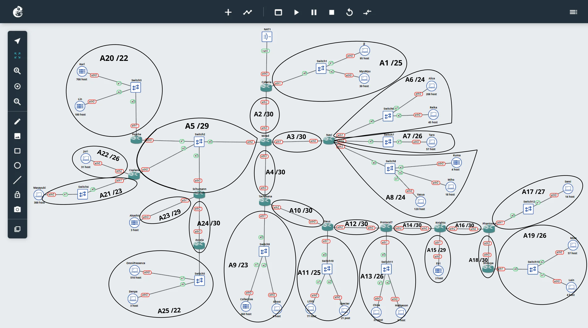
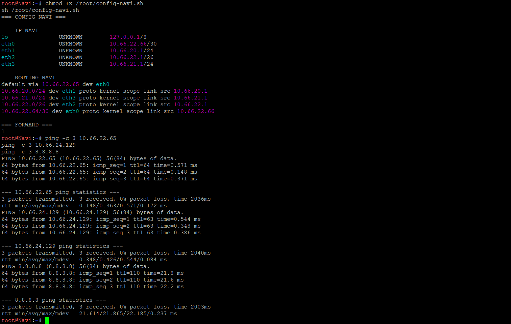
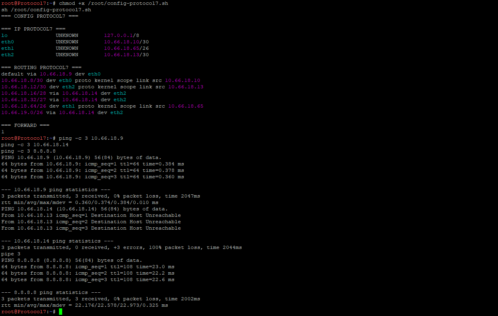
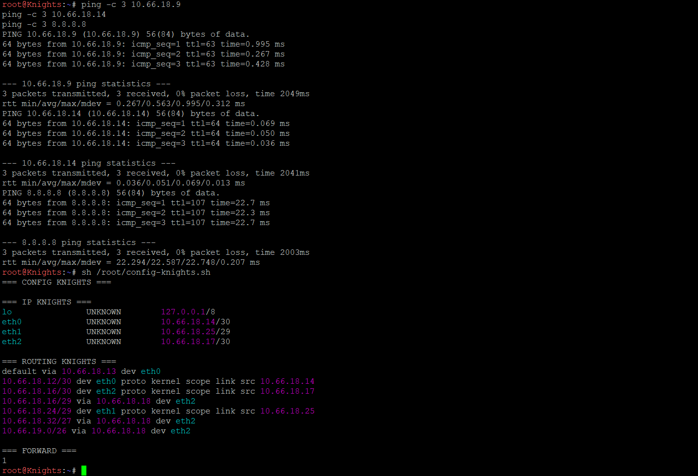
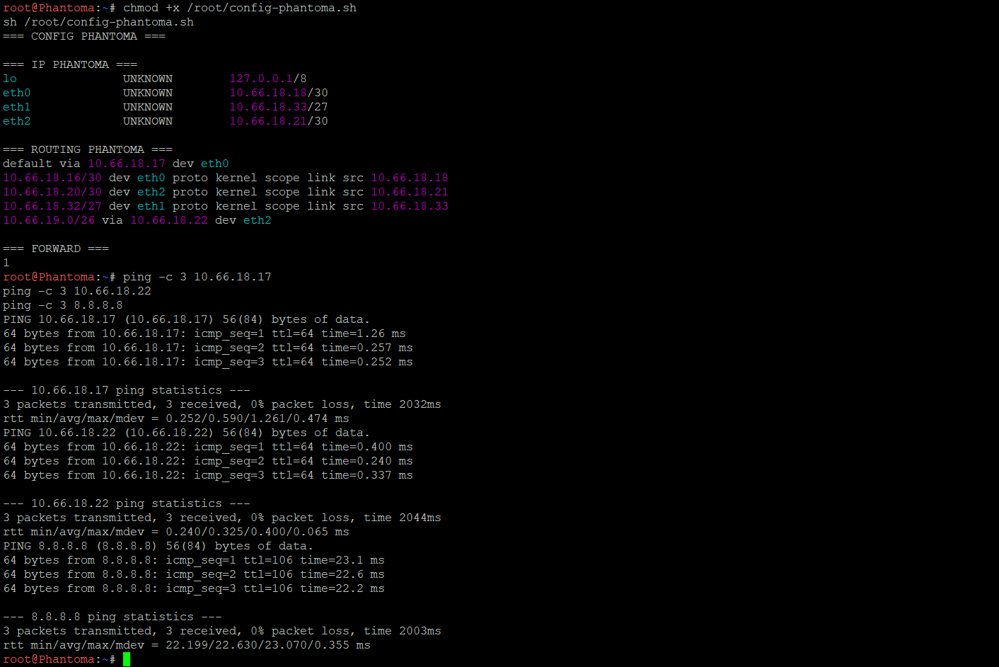
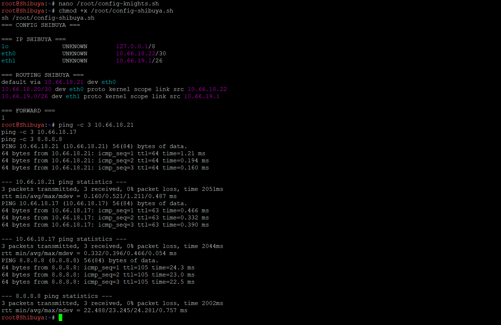
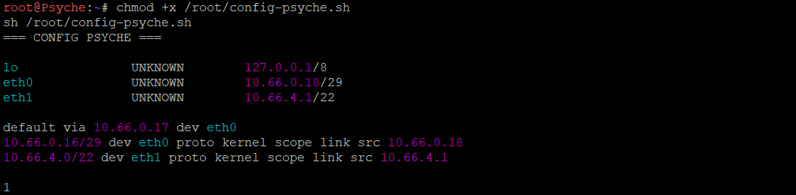
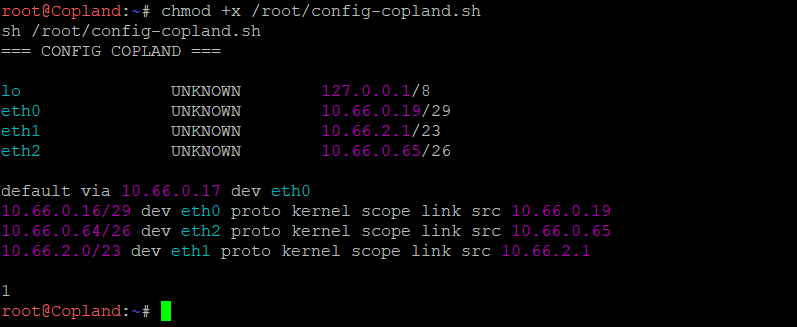
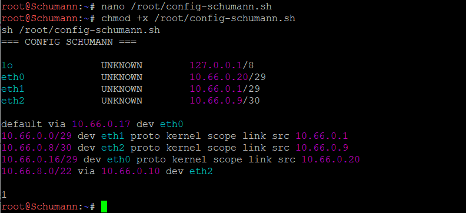

# Jarkom-Modul-4-2026-K-05

# PRAKTIKUM JARINGAN KOMPUTER - MODUL 4

## Subnetting dan Routing - GNS3 (CIDR)

### Anggota Kelompok

| Nama | NRP |
| --- | --- |
| Ronnin Raditya Putra Purbono | 5027251119 |
| Keisya Halimah Mulia | 5027251068 |

## Laporan

- Spreadsheet subnetting: `https://docs.google.com/spreadsheets/d/1tnrkMIINtIfA9lkkEz2IxHoiGxdWwslZ/edit?usp=sharing&ouid=105300267501229657358&rtpof=true&sd=true`

Laporan ini membahas bagian GNS3 dengan metode CIDR. Bagian Cisco Packet Tracer (VLSM) tidak disertakan karena bukti dan laporan yang disiapkan berfokus pada GNS3. Perhitungan VLSM tetap dilampirkan sebagai bukti pada spreadsheet.

### Bukti Screenshot Spreadsheet

| No | Tab Spreadsheet | Bukti Screenshot |
|---|---|---|
| 1 | Rute | [PLACEHOLDER] `Assets/rute.png` |
| 2 | Rute VLSM | [PLACEHOLDER] `Assets/rute-vlsm.png` |
| 3 | Pembagian IP - VLSM | [PLACEHOLDER] `Assets/pembagian-ip-vlsm.png` |
| 4 | Penggabungan CIDR | [PLACEHOLDER] `Assets/penggabungan-cidr.png` |
| 5 | Pembagian IP CIDR | [PLACEHOLDER] `Assets/pembagian-ip-cidr.png` |

## 1. Topologi GNS3

Topologi disusun dengan Cyberia sebagai router tepi yang terhubung ke NAT, Wired sebagai router distribusi, serta cabang Navi, Tachibana–Deus–Protocol7–Knights–Phantoma–Shibuya, dan Psyche/Copland/Schumann–Accela. Setiap segmen LAN menggunakan alamat IP sesuai hasil pembagian CIDR pada spreadsheet.

[PLACEHOLDER GAMBAR TOPOLOGI FINAL] Simpan screenshot seluruh topologi dengan nama `Assets/topologi-gns3.png`.

## 2. Analisis Kebutuhan Subnet

Berdasarkan tab Rute pada spreadsheet, terdapat 25 subnet (A1–A25), dengan total kebutuhan 2.814 IP dan jumlah kapasitas blok 4.188 alamat. Kapasitas tersebut merupakan penjumlahan block size tiap subnet, termasuk alamat network dan broadcast; bukan jumlah seluruh host yang dapat digunakan.

Subnet terdiri atas jaringan LAN client, satu LAN multi-router bersama (A5), dan link antar-router dengan prefix kecil (umumnya /30).

Ilustrasi pembagian subnet A1–A25



### Daftar Network ID dan Prefix CIDR

| Subnet | Network ID / Prefix | Segmen |
|---|---|---|
| A1 | 10.66.24.0/25 | Cyberia – JJ/MyuMyu |
| A2 | 10.66.24.128/30 | Cyberia – Wired |
| A3 | 10.66.22.64/30 | Wired – Navi |
| A4 | 10.66.18.0/30 | Wired – Tachibana |
| A5 | 10.66.0.16/29 | Wired – Psyche/Copland/Schumann |
| A6 | 10.66.20.0/24 | Navi – Alice/Reika |
| A7 | 10.66.22.0/26 | Navi – Taro |
| A8 | 10.66.21.0/24 | Navi – Yasuo/Miho/Kuma |
| A9 | 10.66.16.0/23 | Tachibana – Collective/Ghost |
| A10 | 10.66.18.4/30 | Tachibana – Deus |
| A11 | 10.66.18.128/25 | Deus – Lillith/Specter |
| A12 | 10.66.18.8/30 | Deus – Protocol7 |
| A13 | 10.66.18.64/26 | Protocol7 – Chisa/Hodgeson |
| A14 | 10.66.18.12/30 | Protocol7 – Knights |
| A15 | 10.66.18.24/29 | Knights – Eiri |
| A16 | 10.66.18.16/30 | Knights – Phantoma |
| A17 | 10.66.18.32/27 | Phantoma – Semi |
| A18 | 10.66.18.20/30 | Phantoma – Shibuya |
| A19 | 10.66.19.0/26 | Shibuya – Lain/Mika |
| A20 | 10.66.4.0/22 | Psyche – Karl/Lin |
| A21 | 10.66.2.0/23 | Copland – Masayuki |
| A22 | 10.66.0.64/26 | Copland – Juri |
| A23 | 10.66.0.0/29 | Schumann – Akashic |
| A24 | 10.66.0.8/30 | Schumann – Accela |
| A25 | 10.66.8.0/22 | Accela – OmniPresence/Denpa |

## 3. Perhitungan Penggabungan CIDR (Supernetting)

CIDR digunakan untuk meringkas sejumlah jaringan yang memiliki jalur keluar sama. Penggabungan subnet dihitung bertahap pada tab Penggabungan - CIDR, lalu alamat setiap subnet ditetapkan pada tab Pembagian IP - CIDR.

### Tree Pembagian CIDR A1–A25

Diagram berikut menunjukkan pembagian hierarkis dari blok induk `10.66.0.0/19` sampai seluruh subnet akhir. Gunakan Mermaid Preview untuk memperbesar dan menggeser diagram.

```mermaid
%%{init: {"flowchart": {"htmlLabels": true, "nodeSpacing": 30, "rankSpacing": 45, "curve": "basis"}}}%%
flowchart TD
    ROOT["10.66.0.0/19"]
    ROOT --> B0["10.66.0.0/20"]
    ROOT --> B16["10.66.16.0/20"]
    ROOT --> B24["10.66.24.0/21"]

    B0 --> B00["10.66.0.0/22"]
    B0 --> B04["10.66.4.0/22"]
    B0 --> B08["10.66.8.0/21"]
    B00 --> A5["A5 - 10.66.0.16/29"]
    B00 --> A21["A21 - 10.66.2.0/23"]
    B00 --> A22["A22 - 10.66.0.64/26"]
    B00 --> A23["A23 - 10.66.0.0/29"]
    B00 --> A24["A24 - 10.66.0.8/30"]
    B04 --> A20["A20 - 10.66.4.0/22"]
    B08 --> A25["A25 - 10.66.8.0/22"]

    B16 --> B160["10.66.16.0/22"]
    B16 --> B180["10.66.18.0/22"]
    B160 --> A9["A9 - 10.66.16.0/23"]
    B180 --> A4["A4 - 10.66.18.0/30"]
    B180 --> A10["A10 - 10.66.18.4/30"]
    B180 --> A11["A11 - 10.66.18.128/25"]
    B180 --> A12["A12 - 10.66.18.8/30"]
    B180 --> A13["A13 - 10.66.18.64/26"]
    B180 --> A14["A14 - 10.66.18.12/30"]
    B180 --> A15["A15 - 10.66.18.24/29"]
    B180 --> A16["A16 - 10.66.18.16/30"]
    B180 --> A17["A17 - 10.66.18.32/27"]
    B180 --> A18["A18 - 10.66.18.20/30"]
    B16 --> A19["A19 - 10.66.19.0/26"]

    B24 --> A1["A1 - 10.66.24.0/25"]
    B24 --> A2["A2 - 10.66.24.128/30"]
    B24 --> A3["A3 - 10.66.22.64/30"]
    B24 --> A6["A6 - 10.66.20.0/24"]
    B24 --> A7["A7 - 10.66.22.0/26"]
    B24 --> A8["A8 - 10.66.21.0/24"]

    classDef root fill:#234e70,stroke:#79b8ff,color:#fff,stroke-width:3px;
    classDef branch fill:#252525,stroke:#888,color:#fff;
    classDef subnet fill:#fff,stroke:#bbb,color:#111,stroke-width:2px;
    class ROOT root;
    class B0,B16,B24,B00,B04,B08,B160,B180 branch;
    class A1,A2,A3,A4,A5,A6,A7,A8,A9,A10,A11,A12,A13,A14,A15,A16,A17,A18,A19,A20,A21,A22,A23,A24,A25 subnet;
```

<div style="overflow:auto; resize:both; width:100%; min-height:420px; border:1px solid #ccc; padding:8px;">



</div>

[PLACEHOLDER] Screenshot tab **Penggabungan CIDR** spreadsheet: `Assets/penggabungan-cidr.png`.

Contoh ringkasan rute yang digunakan dalam implementasi:

| Router | Route ringkasan / static route | Next hop |
|---|---|---|
| Cyberia | 10.66.0.0/19 | 10.66.24.130 (Wired) |
| Wired | 10.66.16.0/22 | 10.66.18.2 (Tachibana) |
| Wired | 10.66.20.0/22 | 10.66.22.66 (Navi) |
| Wired | 10.66.8.0/22 | 10.66.0.20 (Schumann) |
| Tachibana | 10.66.18.0/23 | 10.66.18.6 (Deus) |
| Schumann | 10.66.8.0/22 | 10.66.0.10 (Accela) |
| Phantoma | 10.66.19.0/26 | 10.66.18.22 (Shibuya) |

Rute yang langsung terhubung ke interface memiliki prefix yang lebih spesifik dan tetap dipilih melalui mekanisme longest prefix match. Karena itu, agregasi rute tidak menggantikan route connected pada router.

[PLACEHOLDER] Tambahkan ilustrasi penggabungan CIDR, misalnya `Assets/cidr-tree.png`, apabila gambar tersebut tersedia.

## 4. Pembagian Alamat IP (Subnetting)

Setelah supernet dihitung, Network ID, netmask, broadcast, dan usable range ditetapkan pada tab Pembagian IP - CIDR. Hasilnya digunakan sebagai dasar penentuan IP setiap interface router dan client.


### Contoh perhitungan: A13 (Protocol7–Chisa–Hodgeson)

Pada spreadsheet, A13 mempunyai kebutuhan 33 IP. Prefix /27 menyediakan 32 alamat (30 usable), sehingga belum mencukupi. Prefix /26 menyediakan 64 alamat (62 usable), sehingga digunakan 10.66.18.64/26:

- Netmask: 255.255.255.192
- Network ID: 10.66.18.64
- Broadcast: 10.66.18.127
- Usable range: 10.66.18.65–10.66.18.126
- Gateway Protocol7 eth1: 10.66.18.65/26; client Chisa 10.66.18.66/26, Hodgeson 10.66.18.67/26.

### Catatan VLSM

Perhitungan VLSM (Cisco Packet Tracer) didokumentasikan pada spreadsheet dan tidak diimplementasikan pada laporan GNS3 ini.

[PLACEHOLDER] Screenshot tab **Rute VLSM** spreadsheet: `Assets/rute-vlsm.png`.

[PLACEHOLDER] Screenshot tab **Pembagian IP - VLSM** spreadsheet: `Assets/pembagian-ip-vlsm.png`.

## 5. Konfigurasi Router dan Static Routing

Konfigurasi pada 13 router menggunakan `ip link`, `ip addr`, `ip route`, dan `net.ipv4.ip_forward=1`. Cyberia menangani koneksi NAT dengan `iptables -t nat ... MASQUERADE` pada eth0; router lain meneruskan paket mengikuti rute yang ditentukan. Seluruh file konfigurasi tersimpan dalam direktori `script/CIDR GNS/router/`.

Pola menjalankan script pada masing-masing router:

```sh
chmod +x /root/config-<nama-router>.sh
sh /root/config-<nama-router>.sh
ip -br -4 addr
ip route
cat /proc/sys/net/ipv4/ip_forward
```

Contoh rute agregasi pada Cyberia:

```sh
ip route replace 10.66.0.0/19 via 10.66.24.130 dev eth2
iptables -t nat -A POSTROUTING -s 10.66.0.0/19 -o eth0 -j MASQUERADE
```

### Rekap konfigurasi dan bukti per router

| Router / script | IP interface utama | Bukti screenshot |
|---|---|---|
| [Cyberia](script/CIDR%20GNS/router/config-cyberia.sh) | 10.66.24.1/25, 10.66.24.129/30 |  |
| [Wired](script/CIDR%20GNS/router/config-wired.sh) | 10.66.24.130/30, 10.66.22.65/30, 10.66.0.17/29, 10.66.18.1/30 | <br> |
| [Navi](script/CIDR%20GNS/router/config-navi.sh) | 10.66.22.66/30, 10.66.20.1/24, 10.66.22.1/26, 10.66.21.1/24 |  |
| [Tachibana](script/CIDR%20GNS/router/config-tachibana.sh) | 10.66.18.2/30, 10.66.16.1/23, 10.66.18.5/30 | <br> |
| [Deus](script/CIDR%20GNS/router/config-deus.sh) | 10.66.18.6/30, 10.66.18.129/25, 10.66.18.9/30 |  |
| [Protocol7](script/CIDR%20GNS/router/config-protocol7.sh) | 10.66.18.10/30, 10.66.18.65/26, 10.66.18.13/30 |  |
| [Knights](script/CIDR%20GNS/router/config-knights.sh) | 10.66.18.14/30, 10.66.18.25/29, 10.66.18.17/30 |  |
| [Phantoma](script/CIDR%20GNS/router/config-phantoma.sh) | 10.66.18.18/30, 10.66.18.33/27, 10.66.18.21/30 |  |
| [Shibuya](script/CIDR%20GNS/router/config-shibuya.sh) | 10.66.18.22/30, 10.66.19.1/26 |  |
| [Psyche](script/CIDR%20GNS/router/config-psyche.sh) | 10.66.0.18/29, 10.66.4.1/22 |  |
| [Copland](script/CIDR%20GNS/router/config-copland.sh) | 10.66.0.19/29, 10.66.2.1/23, 10.66.0.65/26 |  |
| [Schumann](script/CIDR%20GNS/router/config-schumann.sh) | 10.66.0.20/29, 10.66.0.1/29, 10.66.0.9/30 |  |
| [Accela](script/CIDR%20GNS/router/config-accela.sh) | 10.66.0.10/30, 10.66.8.1/22 |  |

## 6. Konfigurasi Static IP Client

Sebanyak 25 client menggunakan satu interface eth0, IP statis sesuai subnet masing-masing, dan default gateway menuju router LAN. Setiap script berada di direktori `clients/`.

Contoh konfigurasi pada Chisa:

```sh
ip link set eth0 up
ip -4 addr flush dev eth0
ip addr add 10.66.18.66/26 dev eth0
ip route replace default via 10.66.18.65 dev eth0
```

| Client / script | Router gateway | Subnet | IP client | Default gateway | Bukti konfigurasi |
|---|---|---|---|---|---|
| [JJ](clients/config-jj.sh) | Cyberia | A1 | 10.66.24.2/25 | 10.66.24.1 | [PLACEHOLDER] `Assets/client-jj-config.png` |
| [MyuMyu](clients/config-myumyu.sh) | Cyberia | A1 | 10.66.24.3/25 | 10.66.24.1 | [PLACEHOLDER] `Assets/client-myumyu-config.png` |
| [Alice](clients/config-alice.sh) | Navi | A6 | 10.66.20.2/24 | 10.66.20.1 | [PLACEHOLDER] `Assets/client-alice-config.png` |
| [Reika](clients/config-reika.sh) | Navi | A6 | 10.66.20.3/24 | 10.66.20.1 | [PLACEHOLDER] `Assets/client-reika-config.png` |
| [Taro](clients/config-taro.sh) | Navi | A7 | 10.66.22.2/26 | 10.66.22.1 | [PLACEHOLDER] `Assets/client-taro-config.png` |
| [Yasuo](clients/config-yasuo.sh) | Navi | A8 | 10.66.21.2/24 | 10.66.21.1 | [PLACEHOLDER] `Assets/client-yasuo-config.png` |
| [Miho](clients/config-miho.sh) | Navi | A8 | 10.66.21.3/24 | 10.66.21.1 | [PLACEHOLDER] `Assets/client-miho-config.png` |
| [Kuma](clients/config-kuma.sh) | Navi | A8 | 10.66.21.4/24 | 10.66.21.1 | [PLACEHOLDER] `Assets/client-kuma-config.png` |
| [Collective](clients/config-collective.sh) | Tachibana | A9 | 10.66.16.2/23 | 10.66.16.1 | [PLACEHOLDER] `Assets/client-collective-config.png` |
| [Ghost](clients/config-ghost.sh) | Tachibana | A9 | 10.66.16.3/23 | 10.66.16.1 | [PLACEHOLDER] `Assets/client-ghost-config.png` |
| [Lillith](clients/config-lillith.sh) | Deus | A11 | 10.66.18.130/25 | 10.66.18.129 | [PLACEHOLDER] `Assets/client-lillith-config.png` |
| [Specter](clients/config-specter.sh) | Deus | A11 | 10.66.18.131/25 | 10.66.18.129 | [PLACEHOLDER] `Assets/client-specter-config.png` |
| [Chisa](clients/config-chisa.sh) | Protocol7 | A13 | 10.66.18.66/26 | 10.66.18.65 | [PLACEHOLDER] `Assets/client-chisa-config.png` |
| [Hodgeson](clients/config-hodgeson.sh) | Protocol7 | A13 | 10.66.18.67/26 | 10.66.18.65 | [PLACEHOLDER] `Assets/client-hodgeson-config.png` |
| [Eiri](clients/config-eiri.sh) | Knights | A15 | 10.66.18.26/29 | 10.66.18.25 | [PLACEHOLDER] `Assets/client-eiri-config.png` |
| [Semi](clients/config-semi.sh) | Phantoma | A17 | 10.66.18.34/27 | 10.66.18.33 | [PLACEHOLDER] `Assets/client-semi-config.png` |
| [Lain](clients/config-lain.sh) | Shibuya | A19 | 10.66.19.2/26 | 10.66.19.1 | [PLACEHOLDER] `Assets/client-lain-config.png` |
| [Mika](clients/config-mika.sh) | Shibuya | A19 | 10.66.19.3/26 | 10.66.19.1 | [PLACEHOLDER] `Assets/client-mika-config.png` |
| [Karl](clients/config-karl.sh) | Psyche | A20 | 10.66.4.2/22 | 10.66.4.1 | [PLACEHOLDER] `Assets/client-karl-config.png` |
| [Lin](clients/config-lin.sh) | Psyche | A20 | 10.66.4.3/22 | 10.66.4.1 | [PLACEHOLDER] `Assets/client-lin-config.png` |
| [Masayuki](clients/config-masayuki.sh) | Copland | A21 | 10.66.2.2/23 | 10.66.2.1 | [PLACEHOLDER] `Assets/client-masayuki-config.png` |
| [Juri](clients/config-juri.sh) | Copland | A22 | 10.66.0.66/26 | 10.66.0.65 | [PLACEHOLDER] `Assets/client-juri-config.png` |
| [Akashic](clients/config-akashic.sh) | Schumann | A23 | 10.66.0.2/29 | 10.66.0.1 | [PLACEHOLDER] `Assets/client-akashic-config.png` |
| [OmniPresence](clients/config-omnipresence.sh) | Accela | A25 | 10.66.8.2/22 | 10.66.8.1 | [PLACEHOLDER] `Assets/client-omnipresence-config.png` |
| [Denpa](clients/config-denpa.sh) | Accela | A25 | 10.66.8.3/22 | 10.66.8.1 | [PLACEHOLDER] `Assets/client-denpa-config.png` |

[PLACEHOLDER 25 SCREENSHOT CLIENT] Ambil hasil `ip -br -4 addr` dan `ip route` dari setiap client. Gunakan nama file `client-<nama>-config.png` sesuai tabel. Tidak ada screenshot konfigurasi client yang dilampirkan dalam kumpulan gambar pada tahap penyusunan README ini.

## 7. Pengujian Konektivitas

Pengujian dibagi menjadi ping tetangga antar-router, router ke LAN client, lintas cabang (cross-subnet), dan akses Internet ke 8.8.8.8. Status ditulis berdasarkan screenshot yang tersedia, bukan asumsi bahwa seluruh node telah lulus.

### 7.1. Bukti pengujian yang sudah tersedia

**Cyberia**: ping ke Wired (10.66.24.130) dan Internet (8.8.8.8) menunjukkan 0% packet loss.

[Lihat bukti](Assets/01-2-cyberia-ping.png)

**Wired**: ping ke Cyberia, Navi, Tachibana, Psyche, Copland, Schumann, dan Internet menunjukkan 0% packet loss.

[Lihat bukti](Assets/02-2-wired-ping.png)

**Navi**: ping ke Alice (10.66.20.2), Reika (10.66.20.3), Taro (10.66.22.2), Yasuo (10.66.21.2), Miho (10.66.21.3), dan Kuma (10.66.21.4) menunjukkan 0% packet loss.

[Lihat bukti](Assets/03-2-navi-ping.png)

**Tachibana**: hasil ping ke Wired, Deus, Cyberia dan Internet yang tampak pada screenshot menunjukkan 0% packet loss.

[PLACEHOLDER] `Assets/tachibana-ping.png`

**Deus**: pada screenshot, ping ke Tachibana (10.66.18.5), Protocol7 (10.66.18.10), Cyberia (10.66.24.129), dan Internet (8.8.8.8) menunjukkan 0% packet loss.

[PLACEHOLDER] `Assets/deus-ping.png`

**Phantoma dan Shibuya**: screenshot masing-masing memperlihatkan keberhasilan ping ke upstream/downstream dan Internet (8.8.8.8), dengan 0% packet loss pada pengujian yang ditampilkan.

[PLACEHOLDER] `Assets/phantoma-ping.png`

[PLACEHOLDER] `Assets/shibuya-ping.png`

### 7.2. Pengujian yang perlu ditambahkan atau diulang

| Sumber | Tujuan | Command | Bukti |
|---|---|---|---|
| Protocol7 | Knights | `ping -c 3 10.66.18.14` | [PLACEHOLDER] `Assets/protocol7-to-knights.png` |
| Knights | Protocol7 | `ping -c 3 10.66.18.13` | [PLACEHOLDER] `Assets/knights-to-protocol7.png` |
| Deus | Lillith | `ping -c 3 10.66.18.130` | [PLACEHOLDER] `Assets/deus-to-lillith.png` |
| Deus | Specter | `ping -c 3 10.66.18.131` | [PLACEHOLDER] `Assets/deus-to-specter.png` |
| Schumann | Akashic | `ping -c 3 10.66.0.2` | [PLACEHOLDER] `Assets/schumann-to-akashic.png` |
| Lain | JJ | `ping -c 3 10.66.24.2` | [PLACEHOLDER] `Assets/lain-to-jj.png` |
| Alice | Denpa | `ping -c 3 10.66.8.3` | [PLACEHOLDER] `Assets/alice-to-denpa.png` |
| Lin | Semi | `ping -c 3 10.66.18.34` | [PLACEHOLDER] `Assets/lin-to-semi.png` |
| Denpa | Taro | `ping -c 3 10.66.22.2` | [PLACEHOLDER] `Assets/denpa-to-taro.png` |
| Lain | Internet | `ping -c 3 8.8.8.8` | [PLACEHOLDER] `Assets/lain-internet.png` |
| Denpa | Internet | `ping -c 3 8.8.8.8` | [PLACEHOLDER] `Assets/denpa-internet.png` |
| Alice | Internet | `ping -c 3 8.8.8.8` | [PLACEHOLDER] `Assets/alice-internet.png` |
| Lin | Internet | `ping -c 3 8.8.8.8` | [PLACEHOLDER] `Assets/lin-internet.png` |

Catatan Protocol7–Knights: pada salah satu screenshot yang dikirim, ping 10.66.18.14 dari Protocol7 masih menghasilkan Destination Host Unreachable. Karena itu, tautan `protocol7-to-knights.png` baru boleh diisi dengan screenshot pengujian ulang yang berhasil, bukan screenshot lama tersebut.

[PLACEHOLDER PING CLIENT] Untuk setiap client, lampirkan screenshot `ping -c 3 <gateway>` bila diwajibkan oleh asisten praktikum. Hasil sukses yang diharapkan adalah `3 packets transmitted, 3 received, 0% packet loss`; status belum dinyatakan lulus tanpa bukti.

## 8. Kesimpulan Sementara

Pembagian CIDR berhasil diterapkan ke konfigurasi 13 router dan 25 client dalam rancangan A1–A25. Bukti yang tersedia menunjukkan pengalamatan IP, static routing, dan forwarding pada router, konektivitas backbone, serta akses Internet pada sejumlah router telah berfungsi. Pengujian Navi ke enam client lokal juga berhasil. Namun, kelengkapan hasil akhir jaringan belum dapat dinyatakan 100% sebelum screenshot uji ulang Protocol7–Knights, ping semua client, dan pengujian lintas cabang yang masih berupa placeholder ditambahkan.