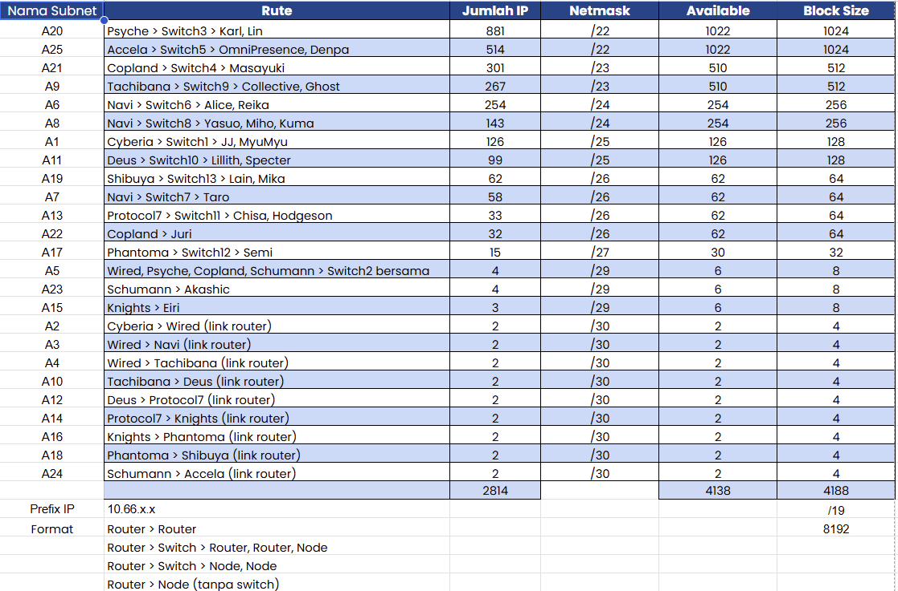
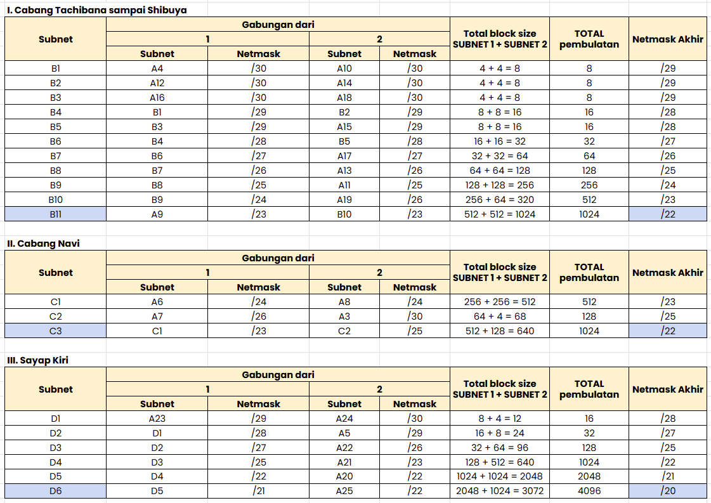
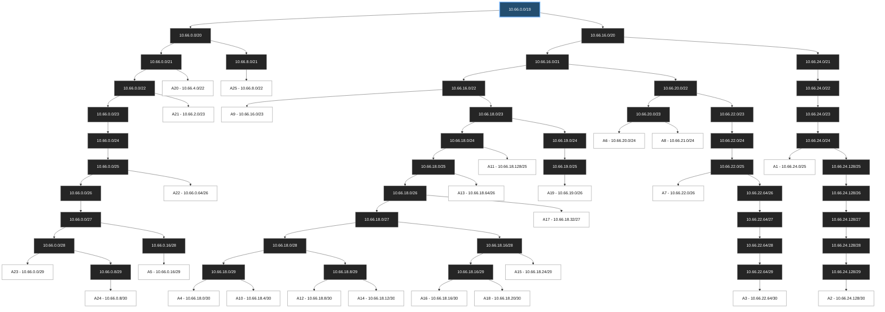

# Jarkom-Modul-4-2026-K-05

# PRAKTIKUM JARINGAN KOMPUTER - MODUL 4

## Subnetting dan Routing - VLSM dan CIDR

### Anggota Kelompok

| Nama | NRP | Tugas |
| --- | --- | --- |
| Ronnin Raditya Putra Purbono | 5027251119 | VLSM Cisco Packet Tracer |
| Keisya Halimah Mulia | 5027251068 | CIDR GNS3 |

## Laporan

- Spreadsheet subnetting: [Buka spreadsheet subnetting](https://docs.google.com/spreadsheets/d/1tnrkMIINtIfA9lkkEz2IxHoiGxdWwslZ/edit?usp=sharing&ouid=105300267501229657358&rtpof=true&sd=true)

Pada laporan ini, kami membahas subnetting dan routing menggunakan VLSM pada Cisco Packet Tracer serta CIDR pada GNS3. Bagian VLSM masih kami tandai sebagai placeholder sampai uraian dan bukti pelaksanaannya dilengkapi.

## Daftar Isi

1. [Topologi GNS3](#1-topologi-gns3)
2. [Analisis Kebutuhan Subnet](#2-analisis-kebutuhan-subnet)
3. [Perhitungan Penggabungan CIDR](#3-perhitungan-penggabungan-cidr-supernetting)
4. [Pembagian Alamat IP](#4-pembagian-alamat-ip-subnetting)
5. [Konfigurasi Router dan Static Routing](#5-konfigurasi-router-dan-static-routing)
6. [Konfigurasi Static IP Client](#6-konfigurasi-static-ip-client)
7. [Pengujian Konektivitas](#7-pengujian-konektivitas)
8. [Kesimpulan Sementara](#8-kesimpulan-sementara)
9. [VLSM Cisco Packet Tracer](#9-vlsm-cisco-packet-tracer-placeholder)

### Bukti Screenshot Spreadsheet

1. **Rute**: [](https://github.com/keisyaahm/Jarkom-Modul-4-2026-K-05/blob/main/Assets/rute1.png)
2. **Rute VLSM**: [](https://github.com/keisyaahm/Jarkom-Modul-4-2026-K-05/blob/main/Assets/rutevlsm.png)
3. **Pembagian IP - VLSM**: [](https://github.com/keisyaahm/Jarkom-Modul-4-2026-K-05/blob/main/Assets/bagiipvlsm.png)
4. **Penggabungan CIDR**: [](https://github.com/keisyaahm/Jarkom-Modul-4-2026-K-05/blob/main/Assets/gabungCIDR.png) [](https://github.com/keisyaahm/Jarkom-Modul-4-2026-K-05/blob/main/Assets/gabungCIDR2.png)
5. **Pembagian IP CIDR**: [](https://github.com/keisyaahm/Jarkom-Modul-4-2026-K-05/blob/main/Assets/bagiIPCIDR.png)

## 1. Topologi GNS3

Pada bagian GNS3, kami menyusun topologi dengan Cyberia sebagai router tepi yang terhubung ke NAT, Wired sebagai router distribusi, serta cabang Navi, Tachibana–Deus–Protocol7–Knights–Phantoma–Shibuya, dan Psyche/Copland/Schumann–Accela. Kami menetapkan alamat setiap segmen LAN berdasarkan hasil pembagian CIDR pada spreadsheet.

[PLACEHOLDER GAMBAR TOPOLOGI FINAL] Simpan screenshot seluruh topologi dengan nama `Assets/topologi-gns3.png`.

## 2. Analisis Kebutuhan Subnet

Berdasarkan tab Rute pada spreadsheet, kami mendapatkan 25 subnet (A1–A25), dengan total kebutuhan 2.814 IP dan jumlah kapasitas blok 4.188 alamat. Kapasitas tersebut merupakan penjumlahan block size tiap subnet, termasuk alamat network dan broadcast, bukan jumlah seluruh host yang dapat digunakan.

Subnet terdiri atas jaringan LAN client, satu LAN multi-router bersama (A5), dan link antar-router dengan prefix kecil (umumnya /30).

Ilustrasi pembagian subnet A1–A25

[](https://github.com/keisyaahm/Jarkom-Modul-4-2026-K-05/blob/main/Assets/subnet1.png)

### Daftar Network ID dan Prefix CIDR

| Subnet | Network ID / Prefix | Segmen |
|---|---|---|
| A1 | 10.66.24.0/25 | Cyberia – JJ/MyuMyu |
| A2 | 10.66.24.128/30 | Cyberia – Wired |
| A3 | 10.66.22.64/30 | Wired – Navi |
| A4 | 10.66.18.0/30 | Wired – Tachibana |
| A5 | 10.66.0.16/29 | Wired – Psyche/Copland/Schumann |
| A6 | 10.66.20.0/24 | Navi – Alice/Reika |
| A7 | 10.66.22.0/26 | Navi – Taro |
| A8 | 10.66.21.0/24 | Navi – Yasuo/Miho/Kuma |
| A9 | 10.66.16.0/23 | Tachibana – Collective/Ghost |
| A10 | 10.66.18.4/30 | Tachibana – Deus |
| A11 | 10.66.18.128/25 | Deus – Lillith/Specter |
| A12 | 10.66.18.8/30 | Deus – Protocol7 |
| A13 | 10.66.18.64/26 | Protocol7 – Chisa/Hodgeson |
| A14 | 10.66.18.12/30 | Protocol7 – Knights |
| A15 | 10.66.18.24/29 | Knights – Eiri |
| A16 | 10.66.18.16/30 | Knights – Phantoma |
| A17 | 10.66.18.32/27 | Phantoma – Semi |
| A18 | 10.66.18.20/30 | Phantoma – Shibuya |
| A19 | 10.66.19.0/26 | Shibuya – Lain/Mika |
| A20 | 10.66.4.0/22 | Psyche – Karl/Lin |
| A21 | 10.66.2.0/23 | Copland – Masayuki |
| A22 | 10.66.0.64/26 | Copland – Juri |
| A23 | 10.66.0.0/29 | Schumann – Akashic |
| A24 | 10.66.0.8/30 | Schumann – Accela |
| A25 | 10.66.8.0/22 | Accela – OmniPresence/Denpa |

## 3. Perhitungan Penggabungan CIDR (Supernetting)

Kami menggunakan CIDR untuk meringkas sejumlah jaringan yang memiliki jalur keluar sama. Kami menghitung penggabungan subnet secara bertahap pada tab Penggabungan - CIDR, lalu menetapkan alamat setiap subnet pada tab Pembagian IP - CIDR.

### Tree Pembagian CIDR A1–A25

Kami menggunakan diagram berikut untuk menunjukkan pembagian hierarkis dari blok induk `10.66.0.0/19` sampai seluruh subnet akhir. Kami menyarankan Mermaid Preview untuk memperbesar dan menggeser diagram.

<div style="overflow:auto; resize:both; width:100%; min-height:420px; border:1px solid #ccc; padding:8px;">



</div>

[](https://github.com/keisyaahm/Jarkom-Modul-4-2026-K-05/blob/main/Assets/gabungCIDR.png)

[](https://github.com/keisyaahm/Jarkom-Modul-4-2026-K-05/blob/main/Assets/gabungCIDR2.png)

Berikut adalah contoh ringkasan rute yang kami gunakan dalam implementasi:

| Router | Route ringkasan / static route | Next hop |
|---|---|---|
| Cyberia | 10.66.0.0/19 | 10.66.24.130 (Wired) |
| Wired | 10.66.16.0/22 | 10.66.18.2 (Tachibana) |
| Wired | 10.66.20.0/22 | 10.66.22.66 (Navi) |
| Wired | 10.66.8.0/22 | 10.66.0.20 (Schumann) |
| Tachibana | 10.66.18.0/23 | 10.66.18.6 (Deus) |
| Schumann | 10.66.8.0/22 | 10.66.0.10 (Accela) |
| Phantoma | 10.66.19.0/26 | 10.66.18.22 (Shibuya) |

Kami mempertahankan rute yang langsung terhubung ke interface dengan prefix yang lebih spesifik agar tetap dipilih melalui mekanisme longest prefix match. Karena itu, agregasi rute tidak menggantikan route connected pada router.

## 4. Pembagian Alamat IP (Subnetting)

Setelah menghitung supernet, kami menetapkan Network ID, netmask, broadcast, dan usable range pada tab Pembagian IP - CIDR. Hasil tersebut kami gunakan sebagai dasar penentuan IP setiap interface router dan client.

[](https://github.com/keisyaahm/Jarkom-Modul-4-2026-K-05/blob/main/Assets/subnet2.png)

### Contoh perhitungan: A13 (Protocol7–Chisa–Hodgeson)

Pada spreadsheet, kami menemukan bahwa A13 mempunyai kebutuhan 33 IP. Prefix /27 menyediakan 32 alamat (30 usable), sehingga belum mencukupi. Kami menggunakan prefix /26 yang menyediakan 64 alamat (62 usable), yaitu 10.66.18.64/26:

- Netmask: 255.255.255.192
- Network ID: 10.66.18.64
- Broadcast: 10.66.18.127
- Usable range: 10.66.18.65–10.66.18.126
- Gateway Protocol7 eth1: 10.66.18.65/26; client Chisa 10.66.18.66/26, Hodgeson 10.66.18.67/26.

### Catatan VLSM

Perhitungan VLSM (Cisco Packet Tracer) sudah kami lampirkan pada spreadsheet, tetapi uraian konfigurasi dan bukti lengkapnya masih kami siapkan pada bagian placeholder di akhir laporan ini.

[](https://github.com/keisyaahm/Jarkom-Modul-4-2026-K-05/blob/main/Assets/rutevlsm.png)

[](https://github.com/keisyaahm/Jarkom-Modul-4-2026-K-05/blob/main/Assets/bagiipvlsm.png)

## 5. Konfigurasi Router dan Static Routing

Kami mengonfigurasi 13 router menggunakan `ip link`, `ip addr`, `ip route`, dan `net.ipv4.ip_forward=1`. Cyberia menangani koneksi NAT dengan `iptables -t nat ... MASQUERADE` pada eth0, sedangkan router lain meneruskan paket mengikuti rute yang kami tentukan. Seluruh file konfigurasi kami simpan dalam direktori `script/CIDR GNS/router/`.

Pola menjalankan script pada masing-masing router:

```sh
chmod +x /root/config-<nama-router>.sh
sh /root/config-<nama-router>.sh
ip -br -4 addr
ip route
cat /proc/sys/net/ipv4/ip_forward
```

Contoh rute agregasi pada Cyberia:

```sh
ip route replace 10.66.0.0/19 via 10.66.24.130 dev eth2
iptables -t nat -A POSTROUTING -s 10.66.0.0/19 -o eth0 -j MASQUERADE
```

### Rekap konfigurasi dan bukti per router

1. **Cyberia**: [script](script/CIDR%20GNS/router/config-cyberia.sh), interface `10.66.24.1/25`, `10.66.24.129/30`<br>
   [](https://github.com/keisyaahm/Jarkom-Modul-4-2026-K-05/blob/main/Assets/01-cyberia-config.png)
2. **Wired**: [script](script/CIDR%20GNS/router/config-wired.sh), interface `10.66.24.130/30`, `10.66.22.65/30`, `10.66.0.17/29`, `10.66.18.1/30`<br>
   [](https://github.com/keisyaahm/Jarkom-Modul-4-2026-K-05/blob/main/Assets/02-1wired-config.png) [](https://github.com/keisyaahm/Jarkom-Modul-4-2026-K-05/blob/main/Assets/02-2wired-config.png)
3. **Navi**: [script](script/CIDR%20GNS/router/config-navi.sh), interface `10.66.22.66/30`, `10.66.20.1/24`, `10.66.22.1/26`, `10.66.21.1/24`<br>
   [](https://github.com/keisyaahm/Jarkom-Modul-4-2026-K-05/blob/main/Assets/03-navi-config.png)
4. **Tachibana**: [script](script/CIDR%20GNS/router/config-tachibana.sh), interface `10.66.18.2/30`, `10.66.16.1/23`, `10.66.18.5/30`<br>
   [](https://github.com/keisyaahm/Jarkom-Modul-4-2026-K-05/blob/main/Assets/04-1tachibana-config.png) [](https://github.com/keisyaahm/Jarkom-Modul-4-2026-K-05/blob/main/Assets/04-2tachibana-config.png)
5. **Deus**: [script](script/CIDR%20GNS/router/config-deus.sh), interface `10.66.18.6/30`, `10.66.18.129/25`, `10.66.18.9/30`<br>
   [](https://github.com/keisyaahm/Jarkom-Modul-4-2026-K-05/blob/main/Assets/05-deus-config.png)
6. **Protocol7**: [script](script/CIDR%20GNS/router/config-protocol7.sh), interface `10.66.18.10/30`, `10.66.18.65/26`, `10.66.18.13/30`<br>
   [](https://github.com/keisyaahm/Jarkom-Modul-4-2026-K-05/blob/main/Assets/06-protocol7-config.png)
7. **Knights**: [script](script/CIDR%20GNS/router/config-knights.sh), interface `10.66.18.14/30`, `10.66.18.25/29`, `10.66.18.17/30`<br>
   [](https://github.com/keisyaahm/Jarkom-Modul-4-2026-K-05/blob/main/Assets/07-knights-config.png)
8. **Phantoma**: [script](script/CIDR%20GNS/router/config-phantoma.sh), interface `10.66.18.18/30`, `10.66.18.33/27`, `10.66.18.21/30`<br>
   [](https://github.com/keisyaahm/Jarkom-Modul-4-2026-K-05/blob/main/Assets/08-phantoma-config.png)
9. **Shibuya**: [script](script/CIDR%20GNS/router/config-shibuya.sh), interface `10.66.18.22/30`, `10.66.19.1/26`<br>
   [](https://github.com/keisyaahm/Jarkom-Modul-4-2026-K-05/blob/main/Assets/09-shibuya-config.png)
10. **Psyche**: [script](script/CIDR%20GNS/router/config-psyche.sh), interface `10.66.0.18/29`, `10.66.4.1/22`<br>
    [](https://github.com/keisyaahm/Jarkom-Modul-4-2026-K-05/blob/main/Assets/10-psyche-config.png)
11. **Copland**: [script](script/CIDR%20GNS/router/config-copland.sh), interface `10.66.0.19/29`, `10.66.2.1/23`, `10.66.0.65/26`<br>
    [](https://github.com/keisyaahm/Jarkom-Modul-4-2026-K-05/blob/main/Assets/11-copland-config.png)
12. **Schumann**: [script](script/CIDR%20GNS/router/config-schumann.sh), interface `10.66.0.20/29`, `10.66.0.1/29`, `10.66.0.9/30`<br>
    [](https://github.com/keisyaahm/Jarkom-Modul-4-2026-K-05/blob/main/Assets/12-schumann-config.png)
13. **Accela**: [script](script/CIDR%20GNS/router/config-accela.sh), interface `10.66.0.10/30`, `10.66.8.1/22`<br>
    [](https://github.com/keisyaahm/Jarkom-Modul-4-2026-K-05/blob/main/Assets/13-accela-config.png)

## 6. Konfigurasi Static IP Client

Kami menggunakan satu interface eth0 pada 25 client, dengan IP statis sesuai subnet masing-masing dan default gateway menuju router LAN. Setiap script berada di direktori `clients/`.

Contoh konfigurasi pada Chisa:

```sh
ip link set eth0 up
ip -4 addr flush dev eth0
ip addr add 10.66.18.66/26 dev eth0
ip route replace default via 10.66.18.65 dev eth0
```

| Client / script | Router gateway | Subnet | IP client | Default gateway | Bukti konfigurasi |
|---|---|---|---|---|---|
| [JJ](clients/config-jj.sh) | Cyberia | A1 | 10.66.24.2/25 | 10.66.24.1 | [PLACEHOLDER] `Assets/client-jj-config.png` |
| [MyuMyu](clients/config-myumyu.sh) | Cyberia | A1 | 10.66.24.3/25 | 10.66.24.1 | [PLACEHOLDER] `Assets/client-myumyu-config.png` |
| [Alice](clients/config-alice.sh) | Navi | A6 | 10.66.20.2/24 | 10.66.20.1 | [PLACEHOLDER] `Assets/client-alice-config.png` |
| [Reika](clients/config-reika.sh) | Navi | A6 | 10.66.20.3/24 | 10.66.20.1 | [PLACEHOLDER] `Assets/client-reika-config.png` |
| [Taro](clients/config-taro.sh) | Navi | A7 | 10.66.22.2/26 | 10.66.22.1 | [PLACEHOLDER] `Assets/client-taro-config.png` |
| [Yasuo](clients/config-yasuo.sh) | Navi | A8 | 10.66.21.2/24 | 10.66.21.1 | [PLACEHOLDER] `Assets/client-yasuo-config.png` |
| [Miho](clients/config-miho.sh) | Navi | A8 | 10.66.21.3/24 | 10.66.21.1 | [PLACEHOLDER] `Assets/client-miho-config.png` |
| [Kuma](clients/config-kuma.sh) | Navi | A8 | 10.66.21.4/24 | 10.66.21.1 | [PLACEHOLDER] `Assets/client-kuma-config.png` |
| [Collective](clients/config-collective.sh) | Tachibana | A9 | 10.66.16.2/23 | 10.66.16.1 | [PLACEHOLDER] `Assets/client-collective-config.png` |
| [Ghost](clients/config-ghost.sh) | Tachibana | A9 | 10.66.16.3/23 | 10.66.16.1 | [PLACEHOLDER] `Assets/client-ghost-config.png` |
| [Lillith](clients/config-lillith.sh) | Deus | A11 | 10.66.18.130/25 | 10.66.18.129 | [PLACEHOLDER] `Assets/client-lillith-config.png` |
| [Specter](clients/config-specter.sh) | Deus | A11 | 10.66.18.131/25 | 10.66.18.129 | [PLACEHOLDER] `Assets/client-specter-config.png` |
| [Chisa](clients/config-chisa.sh) | Protocol7 | A13 | 10.66.18.66/26 | 10.66.18.65 | [PLACEHOLDER] `Assets/client-chisa-config.png` |
| [Hodgeson](clients/config-hodgeson.sh) | Protocol7 | A13 | 10.66.18.67/26 | 10.66.18.65 | [PLACEHOLDER] `Assets/client-hodgeson-config.png` |
| [Eiri](clients/config-eiri.sh) | Knights | A15 | 10.66.18.26/29 | 10.66.18.25 | [PLACEHOLDER] `Assets/client-eiri-config.png` |
| [Semi](clients/config-semi.sh) | Phantoma | A17 | 10.66.18.34/27 | 10.66.18.33 | [PLACEHOLDER] `Assets/client-semi-config.png` |
| [Lain](clients/config-lain.sh) | Shibuya | A19 | 10.66.19.2/26 | 10.66.19.1 | [PLACEHOLDER] `Assets/client-lain-config.png` |
| [Mika](clients/config-mika.sh) | Shibuya | A19 | 10.66.19.3/26 | 10.66.19.1 | [PLACEHOLDER] `Assets/client-mika-config.png` |
| [Karl](clients/config-karl.sh) | Psyche | A20 | 10.66.4.2/22 | 10.66.4.1 | [PLACEHOLDER] `Assets/client-karl-config.png` |
| [Lin](clients/config-lin.sh) | Psyche | A20 | 10.66.4.3/22 | 10.66.4.1 | [PLACEHOLDER] `Assets/client-lin-config.png` |
| [Masayuki](clients/config-masayuki.sh) | Copland | A21 | 10.66.2.2/23 | 10.66.2.1 | [PLACEHOLDER] `Assets/client-masayuki-config.png` |
| [Juri](clients/config-juri.sh) | Copland | A22 | 10.66.0.66/26 | 10.66.0.65 | [PLACEHOLDER] `Assets/client-juri-config.png` |
| [Akashic](clients/config-akashic.sh) | Schumann | A23 | 10.66.0.2/29 | 10.66.0.1 | [PLACEHOLDER] `Assets/client-akashic-config.png` |
| [OmniPresence](clients/config-omnipresence.sh) | Accela | A25 | 10.66.8.2/22 | 10.66.8.1 | [PLACEHOLDER] `Assets/client-omnipresence-config.png` |
| [Denpa](clients/config-denpa.sh) | Accela | A25 | 10.66.8.3/22 | 10.66.8.1 | [PLACEHOLDER] `Assets/client-denpa-config.png` |

[PLACEHOLDER 25 SCREENSHOT CLIENT] Ambil hasil `ip -br -4 addr` dan `ip route` dari setiap client. Gunakan nama file `client-<nama>-config.png` sesuai tabel. Tidak ada screenshot konfigurasi client yang dilampirkan dalam kumpulan gambar pada tahap penyusunan README ini.

## 7. Pengujian Konektivitas

Kami membagi pengujian menjadi ping tetangga antar-router, router ke LAN client, lintas cabang (cross-subnet), dan akses Internet ke 8.8.8.8. Kami menulis status berdasarkan screenshot yang tersedia, bukan berdasarkan asumsi bahwa seluruh node telah lulus.

### 7.1. Bukti pengujian yang sudah tersedia

**Cyberia**: ping ke Wired (10.66.24.130) dan Internet (8.8.8.8) menunjukkan 0% packet loss.

[Lihat bukti](Assets/01-2-cyberia-ping.png)

**Wired**: ping ke Cyberia, Navi, Tachibana, Psyche, Copland, Schumann, dan Internet menunjukkan 0% packet loss.

[Lihat bukti](Assets/02-2-wired-ping.png)

**Navi**: ping ke Alice (10.66.20.2), Reika (10.66.20.3), Taro (10.66.22.2), Yasuo (10.66.21.2), Miho (10.66.21.3), dan Kuma (10.66.21.4) menunjukkan 0% packet loss.

[Lihat bukti](Assets/03-2-navi-ping.png)

**Tachibana**: hasil ping ke Wired, Deus, Cyberia dan Internet yang tampak pada screenshot menunjukkan 0% packet loss.

[PLACEHOLDER] `Assets/tachibana-ping.png`

**Deus**: pada screenshot, ping ke Tachibana (10.66.18.5), Protocol7 (10.66.18.10), Cyberia (10.66.24.129), dan Internet (8.8.8.8) menunjukkan 0% packet loss.

[PLACEHOLDER] `Assets/deus-ping.png`

**Phantoma dan Shibuya**: screenshot masing-masing memperlihatkan keberhasilan ping ke upstream/downstream dan Internet (8.8.8.8), dengan 0% packet loss pada pengujian yang ditampilkan.

[PLACEHOLDER] `Assets/phantoma-ping.png`

[PLACEHOLDER] `Assets/shibuya-ping.png`

### 7.2. Pengujian yang perlu ditambahkan atau diulang

| Sumber | Tujuan | Command | Bukti |
|---|---|---|---|
| Protocol7 | Knights | `ping -c 3 10.66.18.14` | [PLACEHOLDER] `Assets/protocol7-to-knights.png` |
| Knights | Protocol7 | `ping -c 3 10.66.18.13` | [PLACEHOLDER] `Assets/knights-to-protocol7.png` |
| Deus | Lillith | `ping -c 3 10.66.18.130` | [PLACEHOLDER] `Assets/deus-to-lillith.png` |
| Deus | Specter | `ping -c 3 10.66.18.131` | [PLACEHOLDER] `Assets/deus-to-specter.png` |
| Schumann | Akashic | `ping -c 3 10.66.0.2` | [PLACEHOLDER] `Assets/schumann-to-akashic.png` |
| Lain | JJ | `ping -c 3 10.66.24.2` | [PLACEHOLDER] `Assets/lain-to-jj.png` |
| Alice | Denpa | `ping -c 3 10.66.8.3` | [PLACEHOLDER] `Assets/alice-to-denpa.png` |
| Lin | Semi | `ping -c 3 10.66.18.34` | [PLACEHOLDER] `Assets/lin-to-semi.png` |
| Denpa | Taro | `ping -c 3 10.66.22.2` | [PLACEHOLDER] `Assets/denpa-to-taro.png` |
| Lain | Internet | `ping -c 3 8.8.8.8` | [PLACEHOLDER] `Assets/lain-internet.png` |
| Denpa | Internet | `ping -c 3 8.8.8.8` | [PLACEHOLDER] `Assets/denpa-internet.png` |
| Alice | Internet | `ping -c 3 8.8.8.8` | [PLACEHOLDER] `Assets/alice-internet.png` |
| Lin | Internet | `ping -c 3 8.8.8.8` | [PLACEHOLDER] `Assets/lin-internet.png` |

Catatan Protocol7–Knights: pada salah satu screenshot yang kami kirim, ping 10.66.18.14 dari Protocol7 masih menghasilkan Destination Host Unreachable. Karena itu, kami hanya akan mengisi tautan `protocol7-to-knights.png` dengan screenshot pengujian ulang yang berhasil, bukan screenshot lama tersebut.

[PLACEHOLDER PING CLIENT] Untuk setiap client, lampirkan screenshot `ping -c 3 <gateway>` bila diwajibkan oleh asisten praktikum. Hasil sukses yang diharapkan adalah `3 packets transmitted, 3 received, 0% packet loss`; status belum dinyatakan lulus tanpa bukti.

## 8. Kesimpulan Sementara

Kami berhasil menerapkan pembagian CIDR pada konfigurasi 13 router dan 25 client dalam rancangan A1–A25. Bukti yang tersedia menunjukkan bahwa pengalamatan IP, static routing, forwarding pada router, konektivitas backbone, serta akses Internet pada sejumlah router telah berfungsi. Pengujian Navi ke enam client lokal juga berhasil. Namun, kami belum dapat menyatakan hasil akhir jaringan 100% lengkap sebelum screenshot uji ulang Protocol7–Knights, ping semua client, dan pengujian lintas cabang yang masih berupa placeholder ditambahkan.

## 9. VLSM Cisco Packet Tracer (PLACEHOLDER)

> **PLACEHOLDER VLSM:** Bagian ini akan diisi oleh Ronnin dengan topologi Cisco Packet Tracer, perhitungan VLSM, konfigurasi perangkat, tabel IP, dan bukti pengujian konektivitas.