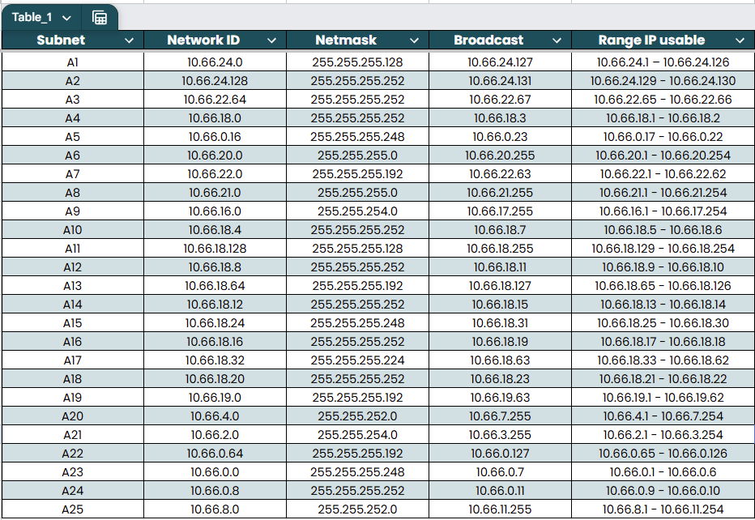
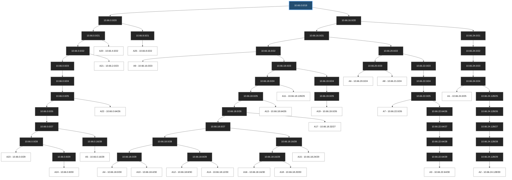

# Jarkom-Modul-4-2026-K-05

## Subnetting dan Routing - VLSM dan CIDR

## 1. Anggota Kelompok

| Nama | NRP | Tugas |
| --- | --- | --- |
| Ronnin Raditya Putra Purbono | 5027251119 | VLSM Cisco Packet Tracer |
| Keisya Halimah Mulia | 5027251068 | CIDR GNS3 |

## Daftar Isi CIDR GNS3

1. [Tujuan Pengerjaan](#3-tujuan-pengerjaan)
2. [Topologi Awal GNS3](#4-topologi-awal-gns3)
3. [Menentukan Jumlah Subnet dari Topologi](#5-menentukan-jumlah-subnet-dari-topologi)
4. [Menghitung Kebutuhan Host dan Prefix](#6-menghitung-kebutuhan-host-dan-prefix)
5. [Pembagian IP A1-A25](#7-pembagian-ip-a1-a25)
6. [Penggabungan CIDR](#8-penggabungan-cidr)
7. [Tree CIDR](#9-tree-cidr)
8. [Tabel Network ID, Broadcast, dan Range IP](#10-tabel-network-id-broadcast-dan-range-ip)
9. [Konfigurasi Router dan Client](#11-konfigurasi-router-dan-client)
10. [Static Routing dan NAT](#12-static-routing-dan-nat)
11. [Testing Konektivitas](#13-testing-konektivitas)
12. [Kesimpulan CIDR](#14-kesimpulan-cidr)

## Daftar Isi VLSM Cisco Packet Tracer

1. [VLSM Cisco Packet Tracer](#15-vlsm-cisco-packet-tracer)

## 2. Laporan dan Spreadsheet

- Laporan dan spreadsheet subnetting: [Buka spreadsheet subnetting](https://docs.google.com/spreadsheets/d/1tnrkMIINtIfA9lkkEz2IxHoiGxdWwslZ/edit?usp=sharing&ouid=105300267501229657358&rtpof=true&sd=true)

Kami mengelompokkan bukti spreadsheet berdasarkan pembahasan. VLSM Cisco Packet Tracer kami letakkan di bagian paling akhir setelah seluruh pembahasan CIDR GNS3.

### Bukti Screenshot Spreadsheet CIDR GNS3

1. **Penggabungan CIDR**: [](https://github.com/keisyaahm/Jarkom-Modul-4-2026-K-05/blob/main/Assets/cidr-gns3/gabungCIDR.png) [](https://github.com/keisyaahm/Jarkom-Modul-4-2026-K-05/blob/main/Assets/cidr-gns3/gabungCIDR2.png)
2. **Pembagian IP CIDR**: [](https://github.com/keisyaahm/Jarkom-Modul-4-2026-K-05/blob/main/Assets/cidr-gns3/bagiIPCIDR.png)

## 3. Tujuan Pengerjaan

Pada praktikum ini kami melakukan subnetting dan routing menggunakan dua pendekatan:

1. VLSM pada Cisco Packet Tracer.
2. CIDR dan route summarization pada GNS3.

Pembahasan CIDR dimulai dari analisis topologi, perhitungan kebutuhan host, pembagian subnet A1-A25, penggabungan subnet menjadi summary route, konfigurasi IP, static routing, dan pengujian konektivitas.

## 4. Topologi Awal GNS3

Sebelum melakukan perhitungan IP, kami membaca topologi GNS3 dan mengidentifikasi setiap segmen jaringan.

Satu LAN client dihitung sebagai satu subnet. Koneksi langsung antar-router juga dihitung sebagai satu subnet karena setiap link point-to-point memiliki network ID sendiri. Selain itu, jaringan bersama antara Wired, Psyche, Copland, dan Schumann dihitung sebagai satu subnet.

Dari topologi tersebut diperoleh 25 subnet, yaitu A1 sampai A25.


## 5. Menentukan Jumlah Subnet dari Topologi

Jumlah subnet ditentukan dari jenis segmen pada topologi, bukan dari jumlah perangkat.

| Jenis jaringan | Subnet | Jumlah |
|---|---|---:|
| LAN client | A1, A6-A9, A11, A13, A15, A17, A19-A23, A25 | 15 |
| Link antar-router | A2, A3, A4, A10, A12, A14, A16, A18, A24 | 9 |
| LAN bersama | A5 | 1 |
| **Total** | **A1-A25** | **25** |


## 6. Menghitung Kebutuhan Host dan Prefix

Setelah jumlah subnet ditentukan dari topologi, kami menghitung kebutuhan IP pada setiap subnet.

Rumus yang digunakan:

`2^h - 2 >= jumlah host`

`h` adalah jumlah bit host. Dua alamat dikurangi karena satu alamat digunakan sebagai network ID dan satu alamat digunakan sebagai broadcast. Prefix dihitung dengan rumus `prefix = 32 - h`.

| Kebutuhan usable IP | Perhitungan | Prefix | Block size |
|---:|---:|---:|---:|
| 2 | 2^2 - 2 = 2 | /30 | 4 |
| 6 | 2^3 - 2 = 6 | /29 | 8 |
| 30 | 2^5 - 2 = 30 | /27 | 32 |
| 62 | 2^6 - 2 = 62 | /26 | 64 |
| 126 | 2^7 - 2 = 126 | /25 | 128 |
| 254 | 2^8 - 2 = 254 | /24 | 256 |
| 1.022 | 2^10 - 2 = 1.022 | /22 | 1.024 |

### Contoh Perhitungan A1

Pada A1, JJ membutuhkan 95 host dan MyuMyu membutuhkan 30 host.

`95 + 30 = 125 host`

Subnet tersebut juga membutuhkan satu alamat untuk gateway Cyberia:

`95 + 30 + 1 gateway = 126 IP usable`

Prefix `/25` menyediakan 128 alamat total:

- Network ID: `10.66.24.0`
- Usable IP: `10.66.24.1-10.66.24.126`
- Broadcast: `10.66.24.127`

Karena `/25` menyediakan 126 IP usable, A1 menggunakan `10.66.24.0/25`.

### Ringkasan kebutuhan subnet

| Subnet | Kebutuhan usable IP | Prefix dipilih | Available | Block size |
|---|---:|---:|---:|---:|
| A1 | 126 | /25 | 126 | 128 |
| A13 | 33 | /26 | 62 | 64 |
| A20 | 881 | /22 | 1.022 | 1.024 |
| A25 | 514 | /22 | 1.022 | 1.024 |


## 7. Pembagian IP A1-A25

Setelah prefix setiap subnet ditentukan, kami menetapkan Network ID, netmask, broadcast, dan range IP usable. Pembagian ini menjadi dasar pengisian alamat interface router dan client.

| Subnet | Network ID | Prefix | Broadcast | Range usable |
|---|---|---:|---|---|
| A1 | 10.66.24.0 | /25 | 10.66.24.127 | 10.66.24.1-10.66.24.126 |
| A4 | 10.66.18.0 | /30 | 10.66.18.3 | 10.66.18.1-10.66.18.2 |
| A13 | 10.66.18.64 | /26 | 10.66.18.127 | 10.66.18.65-10.66.18.126 |
| A20 | 10.66.4.0 | /22 | 10.66.7.255 | 10.66.4.1-10.66.7.254 |
| A25 | 10.66.8.0 | /22 | 10.66.11.255 | 10.66.8.1-10.66.11.254 |


## 8. Penggabungan CIDR

Setelah subnet A1-A25 ditentukan, kami menggabungkan subnet berdasarkan wilayah topologi dan jalur routing yang sama. Penggabungan menggunakan block size, bukan jumlah usable IP. Hasil penjumlahan dibulatkan ke block size CIDR valid berikutnya.

Contoh: A4 `/30` = 4 alamat dan A10 `/30` = 4 alamat. Jadi 4 + 4 = 8 alamat, atau `/29`. Maka A4 dan A10 membentuk summary B1 `/29`.

### Penggabungan Seluruh Wilayah

| Summary | Gabungan | Hasil |
|---|---|---:|
| B11 | A9 dan jaringan Tachibana-Shibuya | /22 |
| C3 | Jaringan cabang Navi | /22 |
| D6 | Schumann, Copland, Psyche, dan Accela | /20 |
| E1 | A1 dan A2 | /24 |
| F1 | B11 dan C3 | /21 |
| F2 | F1 dan E1 | /20 |
| F3 | D6 dan F2 | /19 |

Penggabungan terakhir adalah D6 `/20` + F2 `/20`: 4.096 + 4.096 = 8.192 alamat, sehingga menjadi `/19`. Blok induknya adalah `10.66.0.0/19`.

[](https://github.com/keisyaahm/Jarkom-Modul-4-2026-K-05/blob/main/Assets/cidr-gns3/gabungCIDR.png)
[](https://github.com/keisyaahm/Jarkom-Modul-4-2026-K-05/blob/main/Assets/cidr-gns3/gabungCIDR2.png)


### Tree Pembagian CIDR A1–A25

Tree CIDR menunjukkan pembagian alamat dari blok induk ke subnet akhir secara top-down. Root tree adalah `10.66.0.0/19`, yang dibagi menjadi `10.66.0.0/20` dan `10.66.16.0/20`. Kami menggunakan diagram berikut untuk menunjukkan pembagian hierarkis dari blok induk `10.66.0.0/19` sampai seluruh subnet akhir. Kami menyarankan Mermaid Preview untuk memperbesar dan menggeser diagram.

<div style="overflow:auto; resize:both; width:100%; min-height:420px; border:1px solid #ccc; padding:8px;">



</div>

## 9. Tree CIDR

Tree CIDR menunjukkan pembagian alamat dari blok induk `10.66.0.0/19` secara top-down sampai subnet akhir.

Spreadsheet `Penggabungan - CIDR` menunjukkan proses bottom-up, sedangkan tree menunjukkan proses top-down.


## 10. Tabel Network ID, Broadcast, dan Range IP

### Pembagian seluruh subnet


| Subnet | Network ID | Prefix | Broadcast | Range usable | Segmen |
|---|---|---:|---|---|---|
| A1 | 10.66.24.0 | /25 | 10.66.24.127 | 10.66.24.1-10.66.24.126 | Cyberia – JJ/MyuMyu |
| A2 | 10.66.24.128 | /30 | 10.66.24.131 | 10.66.24.129-10.66.24.130 | Cyberia – Wired |
| A3 | 10.66.22.64 | /30 | 10.66.22.67 | 10.66.22.65-10.66.22.66 | Wired – Navi |
| A4 | 10.66.18.0 | /30 | 10.66.18.3 | 10.66.18.1-10.66.18.2 | Wired – Tachibana |
| A5 | 10.66.0.16 | /29 | 10.66.0.23 | 10.66.0.17-10.66.0.22 | Wired – Psyche/Copland/Schumann |
| A6 | 10.66.20.0 | /24 | 10.66.20.255 | 10.66.20.1-10.66.20.254 | Navi – Alice/Reika |
| A7 | 10.66.22.0 | /26 | 10.66.22.63 | 10.66.22.1-10.66.22.62 | Navi – Taro |
| A8 | 10.66.21.0 | /24 | 10.66.21.255 | 10.66.21.1-10.66.21.254 | Navi – Yasuo/Miho/Kuma |
| A9 | 10.66.16.0 | /23 | 10.66.17.255 | 10.66.16.1-10.66.17.254 | Tachibana – Collective/Ghost |
| A10 | 10.66.18.4 | /30 | 10.66.18.7 | 10.66.18.5-10.66.18.6 | Tachibana – Deus |
| A11 | 10.66.18.128 | /25 | 10.66.18.255 | 10.66.18.129-10.66.18.254 | Deus – Lillith/Specter |
| A12 | 10.66.18.8 | /30 | 10.66.18.11 | 10.66.18.9-10.66.18.10 | Deus – Protocol7 |
| A13 | 10.66.18.64 | /26 | 10.66.18.127 | 10.66.18.65-10.66.18.126 | Protocol7 – Chisa/Hodgeson |
| A14 | 10.66.18.12 | /30 | 10.66.18.15 | 10.66.18.13-10.66.18.14 | Protocol7 – Knights |
| A15 | 10.66.18.24 | /29 | 10.66.18.31 | 10.66.18.25-10.66.18.30 | Knights – Eiri |
| A16 | 10.66.18.16 | /30 | 10.66.18.19 | 10.66.18.17-10.66.18.18 | Knights – Phantoma |
| A17 | 10.66.18.32 | /27 | 10.66.18.63 | 10.66.18.33-10.66.18.62 | Phantoma – Semi |
| A18 | 10.66.18.20 | /30 | 10.66.18.23 | 10.66.18.21-10.66.18.22 | Phantoma – Shibuya |
| A19 | 10.66.19.0 | /26 | 10.66.19.63 | 10.66.19.1-10.66.19.62 | Shibuya – Lain/Mika |
| A20 | 10.66.4.0 | /22 | 10.66.7.255 | 10.66.4.1-10.66.7.254 | Psyche – Karl/Lin |
| A21 | 10.66.2.0 | /23 | 10.66.3.255 | 10.66.2.1-10.66.3.254 | Copland – Masayuki |
| A22 | 10.66.0.64 | /26 | 10.66.0.127 | 10.66.0.65-10.66.0.126 | Copland – Juri |
| A23 | 10.66.0.0 | /29 | 10.66.0.7 | 10.66.0.1-10.66.0.6 | Schumann – Akashic |
| A24 | 10.66.0.8 | /30 | 10.66.0.11 | 10.66.0.9-10.66.0.10 | Schumann – Accela |
| A25 | 10.66.8.0 | /22 | 10.66.11.255 | 10.66.8.1-10.66.11.254 | Accela – OmniPresence/Denpa |

Tabel ini menjadi referensi final untuk konfigurasi interface router dan client.


## 11. Konfigurasi Router dan Client

Kami mengonfigurasi 13 router menggunakan `ip link`, `ip addr`, `ip route`, dan `net.ipv4.ip_forward=1`. Cyberia menangani koneksi NAT dengan `iptables -t nat ... MASQUERADE` pada eth0, sedangkan router lain meneruskan paket mengikuti rute yang kami tentukan. Seluruh file konfigurasi kami simpan dalam direktori `script/CIDR GNS/router/`.

Pola menjalankan script pada masing-masing router:

```sh
chmod +x /root/config-<nama-router>.sh
sh /root/config-<nama-router>.sh
ip -br -4 addr
ip route
cat /proc/sys/net/ipv4/ip_forward
```

Contoh rute agregasi pada Cyberia:

```sh
ip route replace 10.66.0.0/19 via 10.66.24.130 dev eth2
iptables -t nat -A POSTROUTING -s 10.66.0.0/19 -o eth0 -j MASQUERADE
```

### Rekap konfigurasi dan bukti per router

1. **Bukti konfigurasi interface Cyberia**: [script](script/CIDR%20GNS/router/config-cyberia.sh), interface `10.66.24.1/25`, `10.66.24.129/30`<br>
   [](https://github.com/keisyaahm/Jarkom-Modul-4-2026-K-05/blob/main/Assets/cidr-gns3/01-cyberia-config.png)
2. **Bukti konfigurasi interface Wired**: [script](script/CIDR%20GNS/router/config-wired.sh), interface `10.66.24.130/30`, `10.66.22.65/30`, `10.66.0.17/29`, `10.66.18.1/30`<br>
   [](https://github.com/keisyaahm/Jarkom-Modul-4-2026-K-05/blob/main/Assets/cidr-gns3/02-1wired-config.png) [](https://github.com/keisyaahm/Jarkom-Modul-4-2026-K-05/blob/main/Assets/cidr-gns3/02-2wired-config.png)
3. **Bukti konfigurasi interface Navi**: [script](script/CIDR%20GNS/router/config-navi.sh), interface `10.66.22.66/30`, `10.66.20.1/24`, `10.66.22.1/26`, `10.66.21.1/24`<br>
   [](https://github.com/keisyaahm/Jarkom-Modul-4-2026-K-05/blob/main/Assets/cidr-gns3/03-navi-config.png)
4. **Bukti konfigurasi interface Tachibana**: [script](script/CIDR%20GNS/router/config-tachibana.sh), interface `10.66.18.2/30`, `10.66.16.1/23`, `10.66.18.5/30`<br>
   [](https://github.com/keisyaahm/Jarkom-Modul-4-2026-K-05/blob/main/Assets/cidr-gns3/04-1tachibana-config.png) [](https://github.com/keisyaahm/Jarkom-Modul-4-2026-K-05/blob/main/Assets/cidr-gns3/04-2tachibana-config.png)
5. **Bukti konfigurasi interface Deus**: [script](script/CIDR%20GNS/router/config-deus.sh), interface `10.66.18.6/30`, `10.66.18.129/25`, `10.66.18.9/30`<br>
   [](https://github.com/keisyaahm/Jarkom-Modul-4-2026-K-05/blob/main/Assets/cidr-gns3/05-deus-config.png)
6. **Bukti konfigurasi interface Protocol7**: [script](script/CIDR%20GNS/router/config-protocol7.sh), interface `10.66.18.10/30`, `10.66.18.65/26`, `10.66.18.13/30`<br>
   [](https://github.com/keisyaahm/Jarkom-Modul-4-2026-K-05/blob/main/Assets/cidr-gns3/06-protocol7-config.png)
7. **Bukti konfigurasi interface Knights**: [script](script/CIDR%20GNS/router/config-knights.sh), interface `10.66.18.14/30`, `10.66.18.25/29`, `10.66.18.17/30`<br>
   [](https://github.com/keisyaahm/Jarkom-Modul-4-2026-K-05/blob/main/Assets/cidr-gns3/07-knights-config.png)
8. **Bukti konfigurasi interface Phantoma**: [script](script/CIDR%20GNS/router/config-phantoma.sh), interface `10.66.18.18/30`, `10.66.18.33/27`, `10.66.18.21/30`<br>
   [](https://github.com/keisyaahm/Jarkom-Modul-4-2026-K-05/blob/main/Assets/cidr-gns3/08-phantoma-config.png)
9. **Bukti konfigurasi interface Shibuya**: [script](script/CIDR%20GNS/router/config-shibuya.sh), interface `10.66.18.22/30`, `10.66.19.1/26`<br>
   [](https://github.com/keisyaahm/Jarkom-Modul-4-2026-K-05/blob/main/Assets/cidr-gns3/09-shibuya-config.png)
10. **Bukti konfigurasi interface Psyche**: [script](script/CIDR%20GNS/router/config-psyche.sh), interface `10.66.0.18/29`, `10.66.4.1/22`<br>
    [](https://github.com/keisyaahm/Jarkom-Modul-4-2026-K-05/blob/main/Assets/cidr-gns3/10-psyche-config.png)
11. **Bukti konfigurasi interface Copland**: [script](script/CIDR%20GNS/router/config-copland.sh), interface `10.66.0.19/29`, `10.66.2.1/23`, `10.66.0.65/26`<br>
    [](https://github.com/keisyaahm/Jarkom-Modul-4-2026-K-05/blob/main/Assets/cidr-gns3/11-copland-config.png)
12. **Bukti konfigurasi interface Schumann**: [script](script/CIDR%20GNS/router/config-schumann.sh), interface `10.66.0.20/29`, `10.66.0.1/29`, `10.66.0.9/30`<br>
    [](https://github.com/keisyaahm/Jarkom-Modul-4-2026-K-05/blob/main/Assets/cidr-gns3/12-schumann-config.png)
13. **Bukti konfigurasi interface Accela**: [script](script/CIDR%20GNS/router/config-accela.sh), interface `10.66.0.10/30`, `10.66.8.1/22`<br>
    [](https://github.com/keisyaahm/Jarkom-Modul-4-2026-K-05/blob/main/Assets/cidr-gns3/13-accela-config.png)

Kami menggunakan satu interface eth0 pada 25 client, dengan IP statis sesuai subnet masing-masing dan default gateway menuju router LAN. Setiap script berada di direktori `clients/`.

Contoh konfigurasi pada Chisa:

```sh
ip link set eth0 up
ip -4 addr flush dev eth0
ip addr add 10.66.18.66/26 dev eth0
ip route replace default via 10.66.18.65 dev eth0
```

| Client / script | Router gateway | Subnet | IP client | Default gateway |
|---|---|---|---|---|
| [JJ](clients/config-jj.sh) | Cyberia | A1 | 10.66.24.2/25 | 10.66.24.1 |
| [MyuMyu](clients/config-myumyu.sh) | Cyberia | A1 | 10.66.24.3/25 | 10.66.24.1 |
| [Alice](clients/config-alice.sh) | Navi | A6 | 10.66.20.2/24 | 10.66.20.1 |
| [Reika](clients/config-reika.sh) | Navi | A6 | 10.66.20.3/24 | 10.66.20.1 |
| [Taro](clients/config-taro.sh) | Navi | A7 | 10.66.22.2/26 | 10.66.22.1 |
| [Yasuo](clients/config-yasuo.sh) | Navi | A8 | 10.66.21.2/24 | 10.66.21.1 |
| [Miho](clients/config-miho.sh) | Navi | A8 | 10.66.21.3/24 | 10.66.21.1 |
| [Kuma](clients/config-kuma.sh) | Navi | A8 | 10.66.21.4/24 | 10.66.21.1 |
| [Collective](clients/config-collective.sh) | Tachibana | A9 | 10.66.16.2/23 | 10.66.16.1 |
| [Ghost](clients/config-ghost.sh) | Tachibana | A9 | 10.66.16.3/23 | 10.66.16.1 |
| [Lillith](clients/config-lillith.sh) | Deus | A11 | 10.66.18.130/25 | 10.66.18.129 |
| [Specter](clients/config-specter.sh) | Deus | A11 | 10.66.18.131/25 | 10.66.18.129 |
| [Chisa](clients/config-chisa.sh) | Protocol7 | A13 | 10.66.18.66/26 | 10.66.18.65 |
| [Hodgeson](clients/config-hodgeson.sh) | Protocol7 | A13 | 10.66.18.67/26 | 10.66.18.65 |
| [Eiri](clients/config-eiri.sh) | Knights | A15 | 10.66.18.26/29 | 10.66.18.25 |
| [Semi](clients/config-semi.sh) | Phantoma | A17 | 10.66.18.34/27 | 10.66.18.33 |
| [Lain](clients/config-lain.sh) | Shibuya | A19 | 10.66.19.2/26 | 10.66.19.1 |
| [Mika](clients/config-mika.sh) | Shibuya | A19 | 10.66.19.3/26 | 10.66.19.1 |
| [Karl](clients/config-karl.sh) | Psyche | A20 | 10.66.4.2/22 | 10.66.4.1 |
| [Lin](clients/config-lin.sh) | Psyche | A20 | 10.66.4.3/22 | 10.66.4.1 |
| [Masayuki](clients/config-masayuki.sh) | Copland | A21 | 10.66.2.2/23 | 10.66.2.1 |
| [Juri](clients/config-juri.sh) | Copland | A22 | 10.66.0.66/26 | 10.66.0.65 |
| [Akashic](clients/config-akashic.sh) | Schumann | A23 | 10.66.0.2/29 | 10.66.0.1 |
| [OmniPresence](clients/config-omnipresence.sh) | Accela | A25 | 10.66.8.2/22 | 10.66.8.1 |
| [Denpa](clients/config-denpa.sh) | Accela | A25 | 10.66.8.3/22 | 10.66.8.1 |

Kami menjalankan script konfigurasi pada setiap client sesuai alamat IP dan gateway yang tercantum pada tabel.

## 12. Static Routing dan NAT

Static route digunakan agar setiap router mengetahui jalur menuju jaringan yang tidak langsung terhubung. Route summary mengurangi jumlah entri routing, sedangkan route connected yang lebih spesifik tetap dipertahankan karena longest prefix match.

Berikut adalah contoh ringkasan rute yang kami gunakan dalam implementasi:

| Router | Route ringkasan / static route | Next hop |
|---|---|---|
| Cyberia | 10.66.0.0/19 | 10.66.24.130 (Wired) |
| Wired | 10.66.16.0/22 | 10.66.18.2 (Tachibana) |
| Wired | 10.66.20.0/22 | 10.66.22.66 (Navi) |
| Wired | 10.66.8.0/22 | 10.66.0.20 (Schumann) |
| Tachibana | 10.66.18.0/23 | 10.66.18.6 (Deus) |
| Schumann | 10.66.8.0/22 | 10.66.0.10 (Accela) |
| Phantoma | 10.66.19.0/26 | 10.66.18.22 (Shibuya) |

Kami mempertahankan rute yang langsung terhubung ke interface dengan prefix yang lebih spesifik agar tetap dipilih melalui mekanisme longest prefix match. Karena itu, agregasi rute tidak menggantikan route connected pada router.

Cyberia menjadi edge router menuju NAT. NAT dilakukan dengan `iptables` menggunakan source blok induk `10.66.0.0/19` dan interface keluar menuju Internet.


## 13. Testing Konektivitas

Kami membagi pengujian menjadi ping tetangga antar-router, router ke LAN client, lintas cabang (cross-subnet), dan akses Internet ke 8.8.8.8. Kami menilai keberhasilan berdasarkan output command yang diperoleh.

### 13.1. Bukti pengujian yang sudah tersedia

**Cyberia**: ping ke Wired (10.66.24.130) dan Internet (8.8.8.8) menunjukkan 0% packet loss.

1. **Bukti ping Cyberia ke Wired dan Internet**: [Lihat bukti](Assets/cidr-gns3/01-2-cyberia-ping.png)

**Wired**: ping ke Cyberia, Navi, Tachibana, Psyche, Copland, Schumann, dan Internet menunjukkan 0% packet loss.

2. **Bukti ping Wired ke jaringan cabang dan Internet**: [Lihat bukti](Assets/cidr-gns3/02-2-wired-ping.png)

**Navi**: ping ke Alice (10.66.20.2), Reika (10.66.20.3), Taro (10.66.22.2), Yasuo (10.66.21.2), Miho (10.66.21.3), dan Kuma (10.66.21.4) menunjukkan 0% packet loss.

3. **Bukti ping Navi ke client dalam jaringan lokal**: [Lihat bukti](Assets/cidr-gns3/03-2-navi-ping.png)

**Tachibana**: uji konektivitas dilakukan langsung dari Tachibana ke Wired, Deus, Cyberia, dan Internet.

```sh
ping -c 3 10.66.24.130
ping -c 3 10.66.18.6
ping -c 3 10.66.24.129
ping -c 3 8.8.8.8
```

Ekspektasi output untuk setiap command:

```text
3 packets transmitted, 3 received, 0% packet loss
```

**Deus**: pengujian dilakukan ke Tachibana (10.66.18.5), Protocol7 (10.66.18.10), Cyberia (10.66.24.129), dan Internet (8.8.8.8). Setiap command harus menghasilkan `3 packets transmitted, 3 received, 0% packet loss`.

**Phantoma dan Shibuya**: pengujian dilakukan ke upstream, downstream, dan Internet (8.8.8.8). Setiap command harus menghasilkan `3 packets transmitted, 3 received, 0% packet loss`.

### 13.2. Skenario pengujian dan ekspektasi output

| Sumber | Tujuan | Command | Ekspektasi output |
|---|---|---|---|
| Protocol7 | Knights | `ping -c 3 10.66.18.14` | `3 packets transmitted, 3 received, 0% packet loss` |
| Knights | Protocol7 | `ping -c 3 10.66.18.13` | `3 packets transmitted, 3 received, 0% packet loss` |
| Deus | Lillith | `ping -c 3 10.66.18.130` | `3 packets transmitted, 3 received, 0% packet loss` |
| Deus | Specter | `ping -c 3 10.66.18.131` | `3 packets transmitted, 3 received, 0% packet loss` |
| Schumann | Akashic | `ping -c 3 10.66.0.2` | `3 packets transmitted, 3 received, 0% packet loss` |
| Lain | JJ | `ping -c 3 10.66.24.2` | `3 packets transmitted, 3 received, 0% packet loss` |
| Alice | Denpa | `ping -c 3 10.66.8.3` | `3 packets transmitted, 3 received, 0% packet loss` |
| Lin | Semi | `ping -c 3 10.66.18.34` | `3 packets transmitted, 3 received, 0% packet loss` |
| Denpa | Taro | `ping -c 3 10.66.22.2` | `3 packets transmitted, 3 received, 0% packet loss` |
| Lain | Internet | `ping -c 3 8.8.8.8` | `3 packets transmitted, 3 received, 0% packet loss` |
| Denpa | Internet | `ping -c 3 8.8.8.8` | `3 packets transmitted, 3 received, 0% packet loss` |
| Alice | Internet | `ping -c 3 8.8.8.8` | `3 packets transmitted, 3 received, 0% packet loss` |
| Lin | Internet | `ping -c 3 8.8.8.8` | `3 packets transmitted, 3 received, 0% packet loss` |

Catatan Protocol7–Knights: jalankan ulang `ping -c 3 10.66.18.14` dari Protocol7 setelah route A14 diperiksa. Pengujian berhasil jika menghasilkan `3 packets transmitted, 3 received, 0% packet loss`.

Setiap pengujian berhasil apabila outputnya memuat `3 packets transmitted, 3 received, 0% packet loss`. Jika berbeda, periksa IP, gateway, route, forwarding, dan NAT.

## 14. Kesimpulan CIDR

Alur CIDR GNS3 dimulai dari pembacaan topologi, penentuan 25 subnet, perhitungan kebutuhan host menggunakan `2^h - 2`, penentuan prefix dengan `32 - h`, pembagian alamat A1-A25, penggabungan menjadi summary route, dan pembentukan blok induk `10.66.0.0/19`.

Konfigurasi router, client, static routing, forwarding, dan NAT kemudian diuji menggunakan ping. Pengujian dinyatakan berhasil apabila menghasilkan `3 packets transmitted, 3 received, 0% packet loss`; hasil yang belum memiliki bukti tidak dianggap sebagai keberhasilan final.


## 15. VLSM Cisco Packet Tracer

> Bagian ini membahas pendekatan VLSM pada Cisco Packet Tracer sebagai pembahasan terpisah dari CIDR GNS3.

### Bukti VLSM Cisco Packet Tracer

1. **Bukti ping Juri ke gateway pada percobaan awal**: [Lihat gambar](https://github.com/keisyaahm/Jarkom-Modul-4-2026-K-05/blob/main/Assets/vlsm-cpt/01_Ping_Juri_Gateway_dan_gagal_awal.png)
2. **Bukti ping Juri ke Masayuki pada percobaan awal**: [Lihat gambar](https://github.com/keisyaahm/Jarkom-Modul-4-2026-K-05/blob/main/Assets/vlsm-cpt/02_Ping_Juri_ke_Masayuki_awal.png)
3. **Bukti ping Masayuki ke Juri berhasil**: [Lihat gambar](https://github.com/keisyaahm/Jarkom-Modul-4-2026-K-05/blob/main/Assets/vlsm-cpt/03_Ping_Masayuki_ke_Juri_berhasil.png)
4. **Bukti ping Karl ke Juri berhasil**: [Lihat gambar](https://github.com/keisyaahm/Jarkom-Modul-4-2026-K-05/blob/main/Assets/vlsm-cpt/04_Ping_Karl_ke_Juri_berhasil.png)
5. **Bukti ping Juri ke Karl sebelum perbaikan**: [Lihat gambar](https://github.com/keisyaahm/Jarkom-Modul-4-2026-K-05/blob/main/Assets/vlsm-cpt/05_Ping_Juri_ke_Karl_sebelum_perbaikan.png)
6. **Bukti OSPF neighbor Copland pada kondisi awal**: [Lihat gambar](https://github.com/keisyaahm/Jarkom-Modul-4-2026-K-05/blob/main/Assets/vlsm-cpt/06_OSPF_Copland_neighbor_awal.png)
7. **Bukti routing table OSPF Copland**: [Lihat gambar](https://github.com/keisyaahm/Jarkom-Modul-4-2026-K-05/blob/main/Assets/vlsm-cpt/07_OSPF_Copland_routing_table.png)
8. **Bukti log adjacency OSPF Copland**: [Lihat gambar](https://github.com/keisyaahm/Jarkom-Modul-4-2026-K-05/blob/main/Assets/vlsm-cpt/08_OSPF_Copland_adjacency_log.png)
9. **Bukti OSPF EXSTART Psyche pada kondisi awal**: [Lihat gambar](https://github.com/keisyaahm/Jarkom-Modul-4-2026-K-05/blob/main/Assets/vlsm-cpt/09_OSPF_Psyche_EXSTART_awal.png)
10. **Bukti ping Juri ke Karl berhasil**: [Lihat gambar](https://github.com/keisyaahm/Jarkom-Modul-4-2026-K-05/blob/main/Assets/vlsm-cpt/10_Ping_Juri_ke_Karl_berhasil.png)
